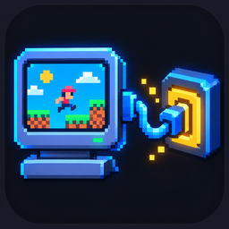

<p align="center">
  
</p>
<h1 align="center"><b>RobloxPortKit</b></h1>
<p align="center">
  The platform layer for shipping PC game ports on Roblox
  <br />
  <a href="#installation"><strong>Install with pesde →</strong></a>
</p>

<div align="center">

[](https://github.com/3xjn/RobloxPortKit/tags)
[](https://pesde.dev)
[](https://luau.org)

</div>

RobloxPortKit owns everything a port needs from the **platform**: a letterboxed
client shell, device-agnostic input, a diff-only GPU scene, bounded image pools,
native audio routing and crash-safe cloud saves. **Your game** owns its
simulation, assets and save schema.

**Ship a port from small, tested building blocks:**

- Host the game in a [shell](#shell) with scaling, pause menu, safe-area HUD and CoreGui control
- Read keyboard, gamepad, touch and pointer drags through one [input](#input) API
- Run deterministic simulation on a [fixed-step clock](#stepper) with speed control
- Draw with a [GPU scene](#gpuscene) that writes zero properties for unchanged frames
- Keep textures bounded with [static and editable image pools](#image-pools)
- Persist progress with merge-safe, idempotent [cloud saves](#cloud-saves)

Used by [xna2luau](https://github.com/3xjn/xna2luau) (the XNA/Monocle
compatibility runtime) and the Celeste and Jump King ports.

<details>
<summary><b>Table of Contents</b></summary>

- [At a Glance](#at-a-glance)
- [Installation](#installation)
- [Reference](#reference)
    - [`createApp(config)`](#createappconfig)
    - [Shell](#shell)
    - [Input](#input)
    - [Pointer drag & drop](#pointer-drag--drop)
    - [Stepper](#stepper)
    - [Preloader](#preloader)
    - [MobileProfile](#mobileprofile)
    - [GpuScene](#gpuscene)
    - [Image pools](#image-pools)
    - [Audio](#audio)
    - [Cloud saves](#cloud-saves)
    - [Benchmark](#benchmark)
- [Asset Pipeline](#asset-pipeline)
- [Development](#development)
- [Releasing](#releasing)

</details>

## At a Glance

```luau
local Kit = require(game.ReplicatedStorage.PortKit)

local app = Kit.createApp({
	name = "MyPort", width = 320, height = 180, scaleMode = "Fit",
	input = {
		bindings = {
			left = { "A", "Left", "DPadLeft" },
			right = { "D", "Right", "DPadRight" },
			jump = { "Space", "ButtonA" },
		},
		layout = "Platformer", touchMode = "Auto",
		actions = { { action = "jump", label = "Jump" } },
	},
	stepper = { rate = 60, maxSteps = 6 },
})

game:GetService("RunService").RenderStepped:Connect(function(dt)
	app.stepper:setSpeed(if app.shell.open then 0 else 1)
	local steps, alpha = app.stepper:advance(dt)
	for _ = 1, steps do
		simTick(app.stepper.stepDt, app.input:axis("left", "right", "X"), app.input:check("jump"))
	end
	render(app.shell.Canvas, alpha)
end)
```

<details>
<summary>Explain code</summary>

```luau
-- Build the shell (canvas, pause modal, HUD) and input in one call.
-- "Fit" letterboxes a 320×180 logical canvas onto any screen.
local app = Kit.createApp({ ... })

-- Bindings mix KeyCode names and gamepad buttons; touch controls appear
-- automatically on touch devices ("Auto" follows the last input device).

-- The stepper is a fixed 60 Hz accumulator. Opening the pause menu sets the
-- speed to 0, so the simulation stops without losing the interpolation fraction.
local steps, alpha = app.stepper:advance(dt)

-- `alpha` interpolates between the previous and current simulation snapshots.
render(app.shell.Canvas, alpha)
```

</details>

## Installation

RobloxPortKit is a [pesde](https://pesde.dev) package installed straight from
this repository by tag. Add it to your `pesde.toml`:

```toml
[dependencies]
PortKit = { repo = "https://github.com/3xjn/RobloxPortKit.git", rev = "v0.3.0" }
```

```sh
pesde install
```

The package lands in `roblox_packages/.pesde/3xjn+robloxportkit/<version>/robloxportkit/`.
Map its `runtime` folder into your Rojo project. Name it `PortKit` if you also
use xna2luau, which requires it as a sibling (`script.Parent.Parent.PortKit`):

```json
"PortKit": { "$path": "roblox_packages/.pesde/3xjn+robloxportkit/<version>/robloxportkit/runtime" }
```

> [!IMPORTANT]
> Add `roblox_packages/**/runtime/*.server.luau` to `globIgnorePaths`. The
> optional `SaveServerAuto` launcher must not run from ReplicatedStorage.

Not using pesde? `python build.py` emits `dist/RobloxPortKit.rbxmx`. Insert it
into ReplicatedStorage.

## Reference

### `createApp(config)`

Creates a `Shell` and an `Input` wired together, plus an optional `Stepper`.
Returns `{shell, input, benchmark, stepper?}`. Call `app:destroy()` when
unloading: every input, camera and character listener is disconnected.
Destroying the viewport also tears down the shell.

### Shell

`Kit.Shell.new(config)` hosts the game:

| Member | Purpose |
| --- | --- |
| `shell.Canvas` | Fixed-resolution logical canvas. Exposes `LogicalWidth` / `LogicalHeight` attributes |
| `shell.HudGui` | ScreenGui using `DeviceSafeInsets`, for touch controls and pause buttons |
| `shell.ViewportGui` | Full-screen ScreenGui that ignores insets |
| `shell.Modal` | Container for settings UI. `shell:setOpen(true)` pauses input and focuses Resume |
| `shell:setScaleMode(mode)` | `Fit`, `PixelPerfect` (integer upscale, proportional downscale) or `Stretch` (resizes the logical canvas) |

The game must pause its own simulation from `shell.open`.

**Pause keys.** `pauseKeys` defaults to Tab and Backquote (Tab only when the
backpack is enabled). A pause key calls `shell.pauseHandler` or toggles the
menu, and is consumed so it can't also open an in-game journal. Text-box focus
passes keys through. Physical Escape is reserved by Roblox, so expose a pause
button in the safe HUD.

**CoreGui.** Backpack, Health, PlayerList and EmotesMenu are disabled by default,
along with PlayerModule controls. The camera is scriptable, orientation is
landscape, and character parts (including ones added later) are hidden, anchored
and non-physical.

- `disableBackpack = false` or `coreGui.Backpack = true` opts into the inventory.
- `singlePlayer = true` or `chat = false` hides CoreGui Chat and the TextChatService window, input bar and bubbles. `chat = true` keeps chat even in single-player mode.
- `coreGui = {Backpack = true, PlayerList = true, ...}` overrides individual entries; omitted non-chat entries default to false.
- CoreGui calls retry up to ten times while the shell is alive. Inject `starterGui` / `textChatService` for headless tests.
- Without `Shell.new`, keep the cleanup function from `Shell.configureCoreGui(config, isAlive)`; it owns a priority-3500 Backquote action.

These settings hide UI; they don't stop the chat service or messages.

> [!TIP]
> In a fresh Studio place, set `StarterPlayer.EnableMouseLockOption = false`,
> remove the default SpawnLocation/Baseplate, and (for single-player) disable the
> TextChatService window, input bar and bubble chat in Edit mode to avoid
> startup UI flashes.

### Input

Bindings use KeyCode names, gamepad buttons, or `MouseButton1` / `MouseButton2`.

| Method | Behavior |
| --- | --- |
| `input:check(action)` | Whether the action is held, across all devices |
| `input:axis(negative, positive, "X" \| "Y")` | Signed axis with analog magnitude preserved |
| `input:consumeBuffer(action, seconds)` | One-shot buffered press, for jump buffering and similar |
| `input:setBehavior(action, mode)` | `Hold`, `Invert` or `Toggle` |
| `input:setTouchMode(mode)` | `Auto`, `On` or `Off` |

L2/R2 use 0.25/0.18 hysteresis, and Gamepad2+ is ignored. Losing focus or
opening a modal clears held inputs and toggles.

**Touch.** Action specs accept `position`, `size` and `anchorPoint`;
`touchLayout` accepts `movePosition` and `moveSize`. Mount controls inside
`shell.HudGui`. Movement is eight-directional, and separate fingers hold and
release actions independently, including sliding off a button and back on.

### Pointer drag & drop

`layout = "Pointer"` maps direct canvas touches to `primary` / `secondary` (with
an explicit right-click toggle) and exposes `input.pointer`:

| Field | Meaning |
| --- | --- |
| `x`, `y`, `inside` | Normalized position, updated on mouse move too |
| `virtualX`, `virtualY` | Unclamped canvas pixels, for hover footprints and range rings |
| `down`, `startX`, `startY`, `deltaX`, `deltaY` | Active press and displacement, in virtual pixels |
| `dragging` | True once distance **exceeds** `dragDeadzone` (default `4`), until release |
| `cancelled` | Set when a modal or focus loss cancels a press. Cleared on the next accepted press |

Call `input:consumeDrop()` once per update. It returns the latest unconsumed
primary release as `{startX, startY, x, y, wasDrag, inside}`, or `nil`. Drops
are one-shot, and a cancelled press never produces a drop. One pointer owns a
gesture at a time. `createApp` accounts for the shell's UI scale; when you
construct `Kit.Input` yourself, pass `canvas` and its `canvasScale`.

<details>
<summary>Example: tower-defense placement with speed control</summary>

```luau
local app = Kit.createApp({
	name = "StrategyPort", width = 960, height = 540,
	input = {
		layout = "Pointer", dragDeadzone = 4,
		bindings = { primary = { "MouseButton1" }, secondary = { "MouseButton2" } },
	},
	stepper = { rate = 60, maxSteps = 6 },
})
local clock, input = app.stepper, app.input
local requestedSpeed = 1 -- wire the game's speed buttons to 1, 3 or 0

game:GetService("RunService").RenderStepped:Connect(function(dt)
	local pointer = input.pointer
	local tower = if pointer.down then shopTowerAt(pointer.startX, pointer.startY) else nil
	if pointer.cancelled or not tower then
		hideFootprint()
	else
		showFootprint(tower, pointer.virtualX, pointer.virtualY,
			pointer.inside and canPlace(tower, pointer.virtualX, pointer.virtualY))
	end

	local drop = input:consumeDrop()
	if drop and drop.wasDrag and drop.inside then
		local dragged = shopTowerAt(drop.startX, drop.startY)
		if dragged and canPlace(dragged, drop.x, drop.y) then
			placeTower(dragged, drop.x, drop.y)
		end
	end

	clock:setSpeed(if app.shell.open then 0 else requestedSpeed)
	local steps, alpha = clock:advance(dt)
	for _ = 1, steps do simTick(clock.stepDt) end
	renderInterpolated(alpha)
end)
```

</details>

### Stepper

`Kit.Stepper.new({rate = 60, maxDelta = 0.25, maxStepsPerFrame = 8})` is a
fixed-timestep accumulator with `stepDt = 1 / rate` (`maxSteps` is an alias).

- `stepper:advance(dt)` returns `(stepsToRun, alpha)` with `alpha` in `[0, 1)`.
- `stepper:setSpeed(n)` runs n× as many ticks; `0` pauses. Speed never changes `stepDt`, and the fractional accumulator is preserved.
- `dt` is clamped to `maxDelta` *before* speed is applied, and work is capped at `ceil(maxStepsPerFrame * speed)` ticks. Lag spikes drop simulation time instead of building an ever-growing backlog.

Given the same inputs and settings, the tick schedule is deterministic.

### Preloader

```luau
local preloader = Kit.Preloader.new({ title = "My Port", accentColor = Color3.fromRGB(91, 140, 255) })
preloader:preload({ sounds = { ... }, images = { ... } })
preloader:setStage("Loading levels", 0.6)
preloader:finish()
```

Preloading deduplicates URIs, uses batches of 10 and returns
`{status, total, completed, failures}`. You can configure `timeoutSec` (8),
`batchSize` and `skipAfterSec` (3; `false` hides Skip). `fail(message)` leaves
an error visible. A timeout or skip can leave assets cold, and Roblox may evict
hidden textures later. Inject `contentProvider`, `instanceFactory` and
`scheduler` for headless use.

### MobileProfile

`MobileProfile.detect({mobile, uis, viewport, maxParkedNodes, residencyWindow})`
flags touch-only devices or viewports with a short side of 540 px or less. The
parked-node budget is 384 on mobile and 2048 on desktop, and the residency
window is 5 screens. GpuScene detects the profile automatically or accepts
`config.mobileProfile`.

### GpuScene

`GpuScene.new(parent)` is a retained, diff-only GUI renderer:

```luau
scene:begin()
scene:image({ ... })                         -- complete properties, stable order
scene:frame({ ... }, cornerRadius?, stroke?)
scene:finish()                               -- hides surplus slots
print(scene.writes)                          -- property writes this frame
```

Every assignment is compared with its previous value, so unchanged frames cost
**zero property writes**. Unused ImageLabels are recycled across crop keys
within the same ImageContent bucket, detached from the hierarchy and kept in a
bounded Lua pool. `imageReserve` warms spare labels per texture, and hidden
labels clear their ImageContent so released pages aren't retained.
`createdImages`, `destroyedImages` and `recycledImages` count lifetimes. On
mobile, parked nodes unused for 180 presentations are hidden and detached.

Release scene references before unpinning their atlas pages.

### Image pools

| Pool | Use it for |
| --- | --- |
| `StaticImagePool` | Immutable atlas pages. `request(id, w, h, pixels)` returns `{content}` or `nil` while a background job stages it |
| `StaticImagePool:import(id, content, w, h, prepare?)` | Already-published `rbxassetid://` images. No decoding or EditableImage staging |
| `AtlasPool.new({maxPages = 32})` | Pages that must stay editable, such as render targets. `acquire`, `pin`, `unpin`, `releasePins`, `remove` |
| `MaterialPool` | SurfaceAppearance materials for mesh draws |

`StaticImagePool` stages through one temporary EditableImage per job and
converts it with `AssetService:CreateDataModelContentAsync`. `maxPages` and
`maxBytes` bound the cache, and `pin` / `unpin` protect visible pages. `await` /
`awaitImport` are for loading workers, never frame callbacks. `AtlasPool`'s hard
limit includes pinned pages: an over-budget scene raises a clear error instead
of exceeding the budget. `EditableImagePolicy` gates every allocation site.

### Audio

`AudioPool.new({wireable = true, audioGraph = graph, ...})` creates native
`AudioPlayer` sources for `AudioBusGraph`, including atlas regions and route-safe
recycling. Supply explicit `info.bus` routes and verified DSP bindings; ordinary
Sounds can't feed Wires. Graph failures warn `[PORT-ERROR]`, record diagnostics
and disconnect the affected output.

### Cloud saves

<details open>
<summary><b>Server</b></summary>

```luau
require(game.ReplicatedStorage.PortKit.SaveServer).start({
	parent = game.ReplicatedStorage.MyPort, remoteName = "CloudSave",
	storeName = "myport_v1",
	blank = function() return { wins = 0 } end,
	validate = function(data)
		if type(data) ~= "table" or type(data.wins) ~= "number"
			or data.wins % 1 ~= 0 or data.wins < 0 or data.wins > 1000000 then
			return false, "invalid wins"
		end
		return true, { wins = data.wins }
	end,
	merge = function(old, incoming, sessionId)
		old.wins = math.max(old.wins, incoming.wins)
		return old
	end,
})
```

</details>

- Loads before writing, validates every payload, serializes each session's requests and merges inside `UpdateAsync`.
- Server revisions only move forward, and per-session sequence receipts make retries idempotent.
- `merge` must be pure, non-yielding and tolerant of stale progress. Use union/max for permanent progress and per-session counters for additive values.
- Pick a remote name that doesn't collide with ModuleScript names. Alternatively, install `SaveServerAuto.server.luau` next to a `PortKitSaveConfig` module.

**Client.** `SaveClient.new({remote, snapshot, apply, onStatus, isDirty?, isStudio?})`
provides `start`, `sync` and `destroy`. `snapshot` returns detached data, and
`apply(data, sentSnapshot)` must keep progress made during the request. Failed
requests retry with the same sequence. Wire a visible **Sync Now** button to
`sync`. In Studio, API failure reports *offline* and never pretends it saved.
Changes are flushed on PlayerRemoving and BindToClose, but sync periodically:
unsynchronized client changes can't be recovered once the server shuts down.

### Benchmark

`Benchmark:record(callbackSeconds, renderInterval)` and `stats()` report rolling
mean/p50/p95/max CPU ms and observed RenderStepped FPS. `Benchmark.stripNative`
(or Python `strip_native`) prepares source for Studio. CPU callback time is not
total frame or GPU time.

## Asset Pipeline

`tools/portkit_bake.py` (no third-party dependencies) handles stable RGBA shelf
packing with gutters and oversized-image tiling, compressed payload modules
under 180,000 characters, and rbxmx packaging.

> [!WARNING]
> **Publish static art upfront.** Upload every static texture page to
> `rbxassetid://` before normal gameplay and draw it via `Content.fromUri`.
> Hundreds of MB of art in ReplicatedStorage ModuleScripts causes 5–15 ms
> decompression and `WritePixelsBuffer` stalls during transitions, evicts
> dynamic caches and hits Roblox's HTTP 413 place-size limit.

- **Keep dynamic staging, and test it.** CPU decompression and EditableImage staging through `StaticImagePool` stay essential for dynamic surfaces such as runtime tile grids, bitmap text caches and procedural masks.
- **Prune independently of GPU delivery.** Use `prune: true` for pure-GPU pages (backgrounds, UI, portraits, mesh textures). Use `prune: false` for pages that also need CPU readback (autotilers, texel samplers, silhouette masks): they still render from `rbxassetid://` but keep their CPU chunks.
- **Curate before batch upload.** Scan decals, posters, portraits, dialog art and audio for Roblox moderation risks. Restyle flagged sprites in the original palette instead of deleting level art, and get before/after approval first. An automated scan can't establish compliance or rights.

## Development

Requires Python 3.10+ and [Lune](https://lune-org.github.io/docs/).

```sh
python build.py --test     # Python + Luau regressions, then dist/RobloxPortKit.rbxmx
```

`python tools/mobile_perf_gate.py` runs the phone performance gate: compiled
Jump King and Celeste frames in Lune with codegen disabled, plus GUI-frame replay
in Studio while it is in Edit mode (`--offline` skips Studio). It writes
`.cache/mobile-perf-gate.json`. Exit 1 means a CPU budget failure; exit 2 means
CPU checks passed but device evidence is incomplete. The gate never certifies
real-device 60 FPS.

Unit tests and Studio emulation are regression evidence, not certification on
real phones or consoles.

## Releasing

1. Commit and push the change to `main` here, with tests passing.
2. Bump `version` in `pesde.toml`, then tag: `git tag -a v0.3.1 -m "..." && git push origin main v0.3.1`.
3. In xna2luau, bump its `PortKit` `rev` if the runtime depends on the change, and tag it too.
4. In each game, bump `rev` in `pesde.toml`, run `pesde install`, regenerate the Rojo project, then verify and commit `pesde.lock`.

Never hand-edit an installed copy under `roblox_packages/`; every change goes
through a tag.
